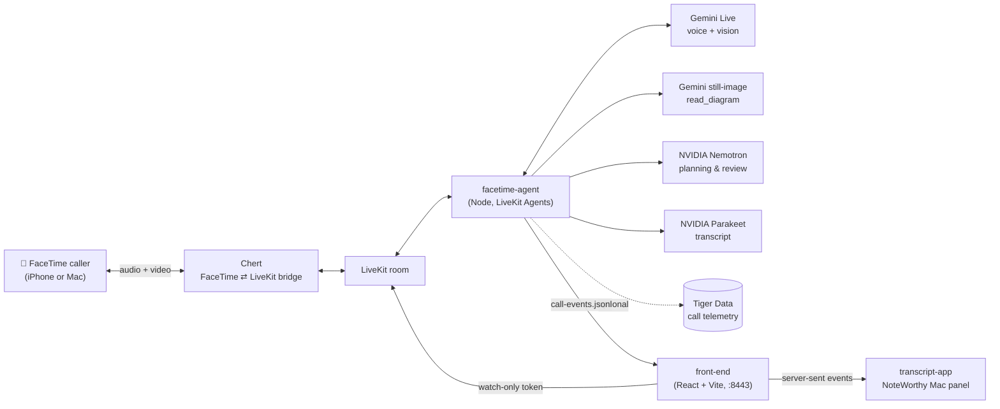

# HACKUTA2026
# NoteWorthy

**An AI note-taker you can FaceTime.** Call a phone number from FaceTime and **Northy**, a live voice-and-video agent, joins the call. It listens, sees your camera, reads the diagrams and whiteboard sketches you hold up, and talks back. Meanwhile a live transcript and chat log fill in on your Mac.

Built at HackUTA 2026.

---

## What it does

- **Talks with you on a real FaceTime Video call.** Northy has a voice (Gemini Live) and an animated face that shows up as its camera.
- **Sees what you show it.** About once a second, frames from your camera go to Gemini. Hold up a drawing or a workflow diagram and Northy walks through it arrow by arrow, then points out the biggest risks and how to fix them.
- **Reads small handwriting.** When it needs to read a whole diagram, a `read_diagram` tool picks the sharpest recent frame, enlarges it and sends it to a still-image Gemini model. That model returns every label, connection and note.
- **Reviews a project outline round by round.** Harder planning questions go to NVIDIA Nemotron. Nemotron says what you fixed since last time, what's still missing, and which tools to use for the database, backend, frontend and hosting.
- **Writes a live transcript.** NVIDIA Parakeet transcribes the caller as they speak. The transcript streams into the web app and into the NoteWorthy Mac panel.
- **Starts and ends calls from the app.** The web app can start a FaceTime call to the agent's line and hang it up.
- **Records call telemetry (optional).** Call start and end, bridge readiness and agent state changes go to a Tiger Data (Timescale) hypertable. Audio and transcripts are not stored.

## How it fits together



1. The caller dials the agent's FaceTime line. Chert bridges the call into a LiveKit room, and the agent joins it.
2. The agent publishes Northy's voice and face. It listens to the caller, watches their camera and calls tools when it needs to: the diagram reader, Nemotron and the Parakeet transcript.
3. Each event (call started, transcript line, agent state, call ended) is added to `facetime-agent/.cache/call-events.jsonl`.
4. The front-end dev server picks those events up and streams them to the browser and to the Mac panel at `/api/call-events`. It can also hand out a hidden, watch-only LiveKit token, so the app can show Northy's camera without disturbing the call.

## Repo layout

| Folder | What's in it |
| --- | --- |
| [`facetime-agent/`](facetime-agent/) | The voice and video agent: LiveKit Agents, Gemini Live, vision, diagram reading, Nemotron delegation, Parakeet transcription, the call-event feed and Tiger Data telemetry. Its [README](facetime-agent/README.md) lists every setting. |
| [`front-end/`](front-end/) | The NoteWorthy web app, designed in Figma and built with Figma Make (React 19, Vite, Tailwind 4, `livekit-client`). Screens: log in, home, live meeting, chat logs and settings. Its dev server also hosts the live call feed and the call start/end API. |
| [`transcript-app/`](transcript-app/) | **NoteWorthy.app**, a small Swift/Cocoa menu bar app. It docks a floating panel on the right edge of the screen with the web app's mini layout, and brings it forward on the live transcript when a call starts. |

## Tech stack

- **Agent:** Node.js 22.23.2+, 24 or 26, `@livekit/agents`, `@livekit/rtc-node`, LiveKit background noise cancellation, `@google/genai`, `sharp`, gRPC (NVIDIA Riva/Parakeet), `pg`
- **Models:** Gemini Live (native audio), a Gemini still-image model for diagrams, NVIDIA Nemotron, NVIDIA Parakeet CTC 1.1B
- **Calls:** Chert for the FaceTime bridge, LiveKit Cloud
- **Web:** React 19, TypeScript, Vite 8, Tailwind CSS 4, Figma Make
- **Mac:** Swift, Cocoa, WebKit
- **Data:** Tiger Data / Timescale PostgreSQL (optional)

## Getting started

### Prerequisites

- A Mac (the call buttons, auto-opened windows and Mac panel use macOS and FaceTime)
- Node.js 22.23.2 or later, and pnpm for the front-end
- The Chert CLI, signed in with `chert login`
- A LiveKit Cloud project, a Gemini API key with Live API access, and optionally an NVIDIA API key from [build.nvidia.com](https://build.nvidia.com)
- The Xcode command line tools, to build the Mac app

### 1. Run the agent

```sh
cd facetime-agent
npm install
cp .env.example .env.local && chmod 600 .env.local
# Fill in LIVEKIT_*, GOOGLE_API_KEY, AGENT_NAME, FACETIME_LINE and, if you have it, NVIDIA_API_KEY
npm start
```

In a second terminal, in the same folder:

```sh
chert dev
```

When `chert dev` says the agent is in a waiting room, it's ready for calls.

### 2. Run the web app

```sh
cd front-end
pnpm install
pnpm dev        # http://localhost:8443
```

### 3. Build the Mac panel (optional)

```sh
cd transcript-app
./build.sh
open build/NoteWorthy.app
```

### 4. Make a call

Press the call button in the web app, or FaceTime Video the line shown by `chert dev`. Northy greets you as soon as FaceTime connects. The web app opens on the live meeting, and the Mac panel comes forward with the transcript filling in.

## Configuration

All agent settings live in `facetime-agent/.env.local`. The most important ones:

| Variable | Purpose |
| --- | --- |
| `LIVEKIT_URL`, `LIVEKIT_API_KEY`, `LIVEKIT_API_SECRET` | LiveKit project (all three from the same project) |
| `GOOGLE_API_KEY` | Gemini key with Live API access |
| `AGENT_NAME` | Unique name the agent registers with; `chert dev` reads it |
| `FACETIME_LINE` | Number the web app's call button dials |
| `NVIDIA_API_KEY` | Turns on Nemotron delegation and Parakeet transcription |
| `TIGER_DATABASE_URL` | Turns on call telemetry (run `sql/001_call_events.sql` first) |

There are also switches for turn-taking, noise cancellation, interruptions (barge-in) and the diagram model. They're all listed in [`facetime-agent/README.md`](facetime-agent/README.md#settings-in-envlocal).

Front-end options: `PORT` (default `8443`) and `CALL_AUTO_OPEN=off` (stops the dev server opening windows when a call starts). Mac app option: `NOTEWORTHY_URL` (default `http://localhost:8443/?mini=1`).

## Tests

```sh
cd facetime-agent
npm test        # mock tests for the diagram reader, Nemotron and Parakeet
npm run check   # syntax check for every module
```

## Notes and limitations

- Seeing the caller needs a FaceTime **Video** call with caller capture turned on for the Chert line. Audio-only calls work, but the caller only hears Northy.
- FaceTime takes audio and video from exactly one participant in the room. Only the agent publishes, and the web app joins as a hidden viewer.
- The call feed (`.cache/call-events.jsonl`) holds the transcript of the latest call on your machine and is git-ignored. Never commit `.env.local`.
- LiveKit, Gemini and NVIDIA usage may cost money.

## Team

Built by [Rishi Nayini](https://github.com/rishinayini), [Prathmesh Durugkar](https://github.com/pumkinhead456), and [Kanishk Kumar](https://github.com/kanishkkumar740) at HackUTA 2026.
